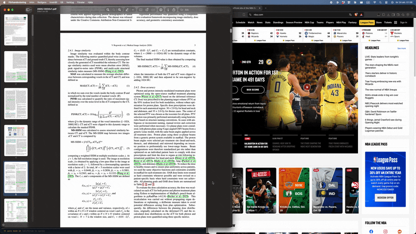

# Shade

A menu bar app for macOS that dims everything except the front window.



- **⌃⌘R** turns Shade on and slides the front window to the center of its screen.
- **Esc** (while Shade is on) turns it off and slides the window back to where it was.
- Picking another window or app, or closing the focused window, also turns Shade off.
  Switching between the window's tabs keeps it on.
- Intensity, "Center Window on Enable" and "Launch at Login" are in the menu bar menu.

- "Lower Volume While Shaded" (off by default) turns the system volume down while Shade is on, and back
  up when it turns off. It leaves the volume alone when the focused window is the one playing, down to
  the browser tab on macOS 14.4+.

Centering needs Accessibility permission (System Settings → Privacy & Security → Accessibility).

Lower Volume While Shaded changes the whole system volume, not just other apps, so when the focused
window and another app both play, it stays put. It recognizes playing tabs in Safari and Chromium
browsers (Chrome, Brave, Edge, …) and has been tried on Safari and Brave; a muted tab counts as playing.

## Build

Download the notarized app from [Releases](https://github.com/guveniscan/Shade/releases), or build from
source (needs the Xcode command line tools, macOS 13+):

```sh
./build.sh   # builds Shade.app, signed with your Developer ID certificate if you have one
open Shade.app
```

Without a Developer ID certificate the app is signed ad-hoc, which changes its identity on every build,
so macOS drops the Accessibility permission after a rebuild; reset it with
`tccutil reset Accessibility com.guveniscan.Shade`.

`./release.sh <version>` builds, notarizes and publishes a GitHub release. It needs a one-time
`xcrun notarytool store-credentials shade-notary`.

## License

MIT, see [LICENSE](LICENSE).
